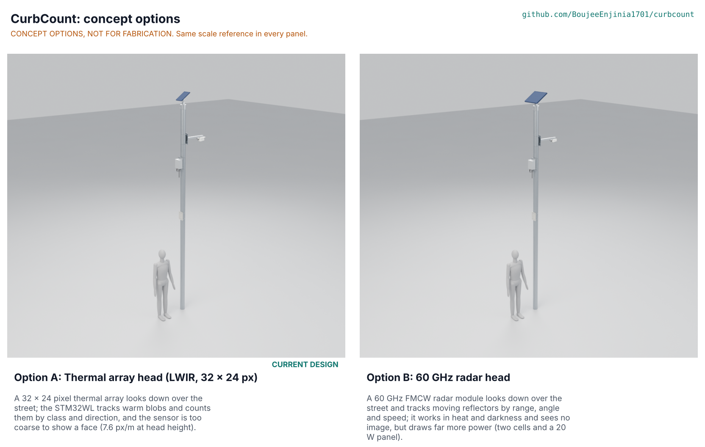

# CurbCount concept options

Two options were scored: A, the current thermal array design, and B, a 60 GHz radar head. A scores 121 against B's 110 (of 165), a gap of 9.1 %, which is inside the 10 % band of STANDARDS section 21, so **both options go to Amish without a pick: Proposed, awaiting Amish**. If he wants a lean, it is the one he already set on 2026-09-25 (CBC-DDR-002): option A for temperate sites and option B as the hot-climate variant. Method: STANDARDS section 21.

*(The picture is rendered from the two CAD models by the coordinator on Amish's Mac with `python .kit/options.py`; the file is not in this commit if that render has not been done yet.)*

## The options

### Option A: Thermal array head (the current design, unchanged)

A 32 x 24 pixel far-infrared array (MLX90640 class, 110 x 75 degree lens) in a printed head on a 498 mm aluminium arm, 4.3 m above the road, looks down over the sidewalk, bike lane and nearest lane. A fixed-point tracker on FieldNode's STM32WL turns warm blobs into counts by class and direction. One cell and FieldNode's 6 W panel power it. At 7.6 px/m at head height it cannot resolve a face or a plate, so privacy is a property of the sensor (S1). Key risks: sunlit pavement hides pedestrians for part of a warm day (S3), cars cross the field in only 4.2 frames (S5), the HDPE window film needs a UV-stable grade (S18). It needs from a co-design partner: a street with manual counts to compare against, in a season with air under 20 degrees C.

### Option B: 60 GHz radar head

A single-chip 60 GHz FMCW radar (IWR6843 class) in a similar head and arm measures the range, angle and speed of everything moving in the cross-section, and a tracker turns the point cloud into counts. Radar works in dark, heat and rain and needs no window film, and Texas Instruments publishes a people counting and tracking reference for the chip. It draws about 1.2 W continuously, so the first drawing (a 20 W panel and radar always on) failed the winter energy balance (S22); the fix, decided under Amish's standing instruction, runs the radar in short frame bursts at about 0.2 W average with two cells and a 20 W panel (CBC-DEC-001 C1). Key risks: false counts from wind-blown foliage (S24), the module cost and 60 GHz rules in each country are unknown (REG G9), the burst rate the tracker needs is to be profiled (S22), the 20 W panel needs FieldNode's high-load charger (S28) and the shared cell is above its charge limit on a hot day without a shield (S26). It needs from a co-design partner: a hot-climate site and a radar-capable bench.

## First-order numbers

Table 1. Options compared.

| Quantity | Option A | Option B |
| --- | --- | --- |
| Estimated parts cost (USD) | 274.00 (BOM, 14 lines) | about 234 without the radar module and its processor (A less the 65.00 array, plus a second cell 9.00 and a 30.00 panel in place of 14.00); module price to assess |
| Mass (kg) | 5.24 (CAL-001 H5); CAD 4.8 | CAD 5.2; 5.64 when the CAD difference is added to option A's sizing (S27); an older estimate with the 20 W panel was 6.02 and the independent review put it nearer 6.8 |
| Output | 15-minute counts, 3 classes x 2 directions, 10-byte record | Same record; radar adds speed and range |
| Energy (stored against load, winter) | 4.4 Wh/day against 2.47; 6.22 days without sun | 14.5 Wh/day against 5.3 at 0.2 W average; 5.8 days (3.2 days at -20 degrees C and end of life) |
| Parts count (cad/fidelity.json) | 127 (81 fasteners) | 128 (81 fasteners) |
| STEM check | 24 rows: 11 within, 11 plausible, 2 fail with a fix proposed (S5 frames per car, S8 cold charging) | 7 rows: 2 within, 3 plausible, 2 fail with a fix proposed (S26 hot cell, S28 charger); shares S8 with A |

Both models are built to D3 with `.kit/cad_parts.py` and pass `python .kit/cad_check.py --export`. Option B shares the pole mount, arm and enclosure with A and differs in the head, the second cell and the larger panel (`cad/src/model.py`, `OPTIONS`).

## Scoring

Table 2. Weighted scoring (weights: High UR 3, Medium 2; scores 1 to 5; the kit criteria buildability and safety weigh 2 and 3).

| Criterion | Source | Weight | A | B | Reason |
| --- | --- | --- | --- | --- | --- |
| Privacy: no image or identity, by physics | UR-006 | 3 | 4 | 5 | A: 7.6 px/m thermal frames held in RAM, below the 25 px/m detection level (S1), but it is still an image of a silhouette. B: radar returns range, angle and speed, never a picture |
| Counts by mode and direction within tolerance | UR-003, UR-004 | 3 | 3 | 4 | A: PR-001 and PR-002 are at risk in CAL-001 C (4.2 frames per car, 6.5 % merging loss). B: speed and range separate walkers, bicycles and cars directly and TI offers a people counting reference, but clutter from foliage and wind is not shown (S24) |
| Whole street from one pole | UR-005 | 3 | 4 | 4 | A: 110 x 75 degree array turned 90 degrees covers -4.45 to 8.34 m with 10.9 degrees of margin (S2). B: a radar head can be aimed to the same cross-section; coverage not yet calculated |
| Counts through the seasons, in sun and shade | UR-009 | 3 | 2 | 5 | A: sunlit pavement hides pedestrians for 10.2 h a day with single frames, 3.2 h with track averaging (S3). B: radar does not depend on surface temperature, light or rain |
| Runs without pole power, winter and dull spells | UR-010 | 3 | 4 | 2 | A: one cell, 6 W panel, 6.22 days, 4.4 Wh/day stored against 2.47 (S6, S7). B: needs a 20 W panel, two cells and duty cycling to 0.2 W to close (S22, S23), a high-load charger (S28) and a shield on hot days (S26); the frame rate needed for tracking is to be profiled |
| Survives five years outdoors | UR-011 | 3 | 3 | 3 | A: HDPE film needs a UV-stabilised grade (S18) and aluminium meets stainless in salt (S19). B: no window film, but a larger panel takes more wind and the radome material is unchosen |
| Cost against the value-engineering target | UR-013 | 3 | 4 | 2 | A: 274.00 USD against 275 (BOM). B: about 234 USD without the radar module; the module price is unknown (TI lists the IWR6843ISK-ODS evaluation module without a price, checked 2026-10-31), so it cannot be shown to fit |
| Set up by two people, light, no pole changes | UR-001, UR-002, UR-015 | 3 | 4 | 3 | A: 5.24 kg, 59 min, 6 W panel of 0.55 kg. B: 20 W panel and a second cell add mass and wind area; CAD mass 5.2 kg, older estimate 6.02 kg against the 6 kg limit |
| Legal radio use and emissions | UR-014 | 2 | 4 | 2 | A: LoRaWAN only (CAL-001 G). B: adds a 60 GHz transmitter whose rules in each country are to assess (REG G9); RF exposure is far below the limit (S21) |
| Buildable with local skills and tools | kit criterion | 2 | 4 | 2 | A: printed housing, a breakout on I2C, hand tools. B: a 60 GHz module needs a vendor board, a toolchain and firmware from the chip maker |
| Safety | kit criterion | 3 | 5 | 4 | A: no emitter. B: a radiating head, with exposure about 12 mW/m2 at head height on a 1 W overestimate against a 10 W/m2 limit (S21) |
| Maintenance | UR-012 | 2 | 3 | 3 | A: one cell, a film that may need changing. B: two cells, no film |
| **Weighted total (of 165)** | | 33 | **121** | **110** | A 73.3 %, B 66.7 %; B is 9.1 % below A |

Scores are the author's judgement from the cited rows and are open to challenge. The two things that most move the gap are the cost row (B's module price is unknown) and the counting row (B's outdoor curb accuracy is not shown); with B's counting at 3 the gap would be 11.6 % and A would lead outright, with B's cost at 3 the gap would be 6.6 %.

## Recommendation

No pick, because the options are within 10 %: **Proposed, awaiting Amish.** Options for his decision: (1) keep A as the build and B as the hot-climate variant, as decided on 2026-09-25 (recommended, because it changes nothing and A scores higher); (2) carry B forward for all sites; (3) design a combined head. The runner-up's best idea to graft onto A is B's duty-cycled frame bursts and speed gating: an idea to test, not a claim: lower the thermal array frame rate when nothing is in the field to cut the 2.47 Wh/day load. This is recorded as open decision O2 in CBC-DEC-001 and argued in CBC-DDR-004. `project.yaml` leaves `concept_chosen` unset.
